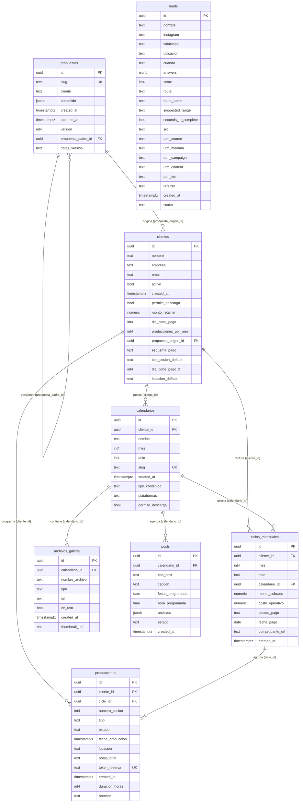

# Modelo de Datos y Esquema de Tablas (Supabase)

> **The Formulab** — Base de Datos Operativa (`public`)  
> Última sincronización con Supabase: Octubre 2026.

Este documento consolida las 8 tablas activas en el esquema público de Supabase, detallando sus columnas, tipos de datos, valores por defecto, claves primarias y relaciones foráneas.

---

## 1. Diagrama de Relaciones Entidad-Relación (ERD)

---

## 2. Detalle de Columnas por Tabla

### `propuestas`
Almacena las cotizaciones y propuestas comerciales dinámicas, soportando ramificaciones e historial de versiones.

| Columna | Tipo | Nulo | Por Defecto | Restricciones / Relaciones | Descripción |
| :--- | :--- | :---: | :--- | :--- | :--- |
| `id` | `uuid` | No | `gen_random_uuid()` | **PK** | Identificador único de la propuesta. |
| `slug` | `text` | No | — | **Unique** | Slug amigable para URL pública (`/propuesta/:slug`). |
| `cliente` | `text` | No | — | | Nombre de la marca o prospecto. |
| `contenido` | `jsonb` | No | — | | Payload estructurado con entregables, inversión y términos. |
| `created_at` | `timestamptz` | Sí | `now()` | | Fecha de creación del registro. |
| `updated_at` | `timestamptz` | Sí | `now()` | | Fecha de última edición. |
| `version` | `integer` | No | `1` | | Número de versión secuencial. |
| `propuesta_padre_id` | `uuid` | Sí | — | **FK** &rarr; `propuestas(id)` | Referencia a la versión raíz/original para agrupación por árbol. |
| `notas_version` | `text` | Sí | — | | Justificación o notas de la negociación para esta versión. |

---

### `clientes`
Ficha central de clientes activos o pasados de la agencia.

| Columna | Tipo | Nulo | Por Defecto | Restricciones / Relaciones | Descripción |
| :--- | :--- | :---: | :--- | :--- | :--- |
| `id` | `uuid` | No | `gen_random_uuid()` | **PK** | Identificador único del cliente. |
| `nombre` | `text` | No | — | | Nombre de la persona o contacto principal. |
| `empresa` | `text` | Sí | — | | Nombre de la empresa o marca comercial. |
| `email` | `text` | Sí | — | | Correo electrónico de contacto. |
| `activo` | `boolean` | Sí | `true` | | Estado operativo (`true` = activo, `false` = pausado/inactivo). |
| `created_at` | `timestamptz` | Sí | `now()` | | Fecha de alta del cliente. |
| `permite_descarga` | `boolean` | No | `false` | | Habilita botones de descarga directa en calendarios. |
| `monto_retainer` | `numeric` | Sí | `0` | | Tarifa recurrente mensual pactada. |
| `dia_corte_pago` | `integer` | Sí | `1` | | Día del mes para cobro (1 al 31). |
| `producciones_por_mes`| `integer` | Sí | `1` | | Cantidad de sesiones de rodaje incluidas al mes. |
| `propuesta_origen_id`| `uuid` | Sí | — | **FK** &rarr; `propuestas(id)` | Propuesta comercial origen desde la cual se dio de alta. |
| `esquema_pago` | `text` | Sí | `'mensual'` | | Esquema de facturación (`mensual`, `quincenal`, etc.). |
| `tipo_sesion_default`| `text` | Sí | `'organica'` | | Formato de rodaje por defecto (`organica`, `profesional`, etc.). |
| `dia_corte_pago_2` | `integer` | Sí | `15` | | Segundo día de corte (para esquemas quincenales). |
| `locacion_default` | `text` | Sí | — | | Locación o dirección habitual para grabaciones. |

---

### `calendarios`
Calendarios editoriales de contenido social vinculados a clientes.

| Columna | Tipo | Nulo | Por Defecto | Restricciones / Relaciones | Descripción |
| :--- | :--- | :---: | :--- | :--- | :--- |
| `id` | `uuid` | No | `gen_random_uuid()` | **PK** | Identificador único del calendario. |
| `cliente_id` | `uuid` | No | — | **FK** &rarr; `clientes(id)` | Cliente propietario del calendario. |
| `nombre` | `text` | No | — | | Título descriptivo (ej. "Noviembre 2026"). |
| `mes` | `integer` | Sí | — | | Mes de publicación (1 a 12). |
| `anio` | `integer` | Sí | — | | Año de publicación (ej. 2026). |
| `slug` | `text` | No | — | **Unique** | Slug amigable para visor público (`/c/:slug`). |
| `created_at` | `timestamptz` | Sí | `now()` | | Fecha de creación. |
| `tipo_contenido` | `text` | Sí | `'Reels y Carruseles'` | | Formatos principales de entrega. |
| `plataformas` | `text` | Sí | `'Instagram y Facebook'` | | Redes o destinos de publicación. |
| `permite_descarga` | `boolean` | Sí | — | | Sobrescribe el permiso general de descarga del cliente. |

---

### `archivos_galeria`
Biblioteca de activos multimedia (videos, imágenes, audios) subidos para un calendario en Cloudflare R2 / Storage.

| Columna | Tipo | Nulo | Por Defecto | Restricciones / Relaciones | Descripción |
| :--- | :--- | :---: | :--- | :--- | :--- |
| `id` | `uuid` | No | `gen_random_uuid()` | **PK** | Identificador único del archivo. |
| `calendario_id` | `uuid` | No | — | **FK** &rarr; `calendarios(id)` | Calendario al que pertenece el archivo. |
| `nombre_archivo` | `text` | No | — | | Nombre original del archivo cargado. |
| `tipo` | `text` | No | — | | Tipo o formato MIME (`video/mp4`, `image/jpeg`, etc.). |
| `url` | `text` | No | — | | URL pública o de descarga del asset. |
| `en_uso` | `boolean` | Sí | `false` | | Indica si el asset ya está asociado a algún post. |
| `created_at` | `timestamptz` | Sí | `now()` | | Fecha y hora de carga. |
| `thumbnail_url` | `text` | Sí | — | | Miniatura estática generada para videos o carruseles. |

---

### `posts`
Publicaciones individuales calendarizadas dentro de un mes editorial.

| Columna | Tipo | Nulo | Por Defecto | Restricciones / Relaciones | Descripción |
| :--- | :--- | :---: | :--- | :--- | :--- |
| `id` | `uuid` | No | `gen_random_uuid()` | **PK** | Identificador único del post. |
| `calendario_id` | `uuid` | No | — | **FK** &rarr; `calendarios(id)` | Calendario al que pertenece la publicación. |
| `tipo_post` | `text` | No | — | | Tipo de post (`Reel`, `Carrusel`, `Estático`, etc.). |
| `caption` | `text` | Sí | — | | Copywriting, ganchos y hashtags de la publicación. |
| `fecha_programada` | `date` | Sí | — | | Fecha estimada de publicación (`YYYY-MM-DD`). |
| `hora_programada` | `time` | Sí | — | | Hora estimada de publicación (`HH:MM:SS`). |
| `archivos` | `jsonb` | Sí | `'[]'::jsonb` | | Lista ordenada de URLs / IDs de assets adjuntos. |
| `estado` | `text` | Sí | `'programado'` | | Estado (`borrador`, `programado`, `aprobado`, etc.). |
| `created_at` | `timestamptz` | Sí | `now()` | | Fecha de creación del post. |

---

### `leads`
Prospectos calificados mediante el formulario interactivo de diagnóstico clínico de The Formulab.

| Columna | Tipo | Nulo | Por Defecto | Restricciones / Relaciones | Descripción |
| :--- | :--- | :---: | :--- | :--- | :--- |
| `id` | `uuid` | No | `gen_random_uuid()` | **PK** | Identificador único del lead. |
| `nombre` | `text` | No | — | | Nombre completo del prospecto. |
| `instagram` | `text` | No | — | | Perfil o arroba de Instagram. |
| `whatsapp` | `text` | No | — | | Teléfono de WhatsApp de contacto. |
| `ubicacion` | `text` | Sí | — | | Ciudad o país del prospecto. |
| `cuando` | `text` | Sí | — | | Ventana temporal para inicio deseado. |
| `answers` | `jsonb` | Sí | — | | Respuestas completas al test de diagnóstico. |
| `score` | `integer` | Sí | `0` | | Puntaje de madurez digital calculado (0 - 100). |
| `route` | `text` | Sí | — | | Identificador de la ruta clínica asignada. |
| `route_name` | `text` | Sí | — | | Nombre formal de la ruta recomendada. |
| `suggested_range` | `text` | Sí | — | | Rango de presupuesto sugerido. |
| `seconds_to_complete`| `integer` | Sí | — | | Tiempo empleado en completar el diagnóstico. |
| `src` | `text` | Sí | — | | Canal de adquisición o tag de origen. |
| `utm_source` | `text` | Sí | — | | Parámetro UTM Source. |
| `utm_medium` | `text` | Sí | — | | Parámetro UTM Medium. |
| `utm_campaign` | `text` | Sí | — | | Parámetro UTM Campaign. |
| `utm_content` | `text` | Sí | — | | Parámetro UTM Content. |
| `utm_term` | `text` | Sí | — | | Parámetro UTM Term. |
| `referrer` | `text` | Sí | — | | Sitio web de procedencia previa. |
| `created_at` | `timestamptz` | Sí | `now()` | | Fecha y hora en que se registró el lead. |
| `status` | `text` | Sí | `'en_espera'` | | Estado del prospecto (`en_espera`, `contactado`, `convertido`, etc.). |

---

### `ciclos_mensuales`
Registro financiero y operativo mensual de cada cliente contratado.

| Columna | Tipo | Nulo | Por Defecto | Restricciones / Relaciones | Descripción |
| :--- | :--- | :---: | :--- | :--- | :--- |
| `id` | `uuid` | No | `gen_random_uuid()` | **PK** | Identificador único del ciclo mensual. |
| `cliente_id` | `uuid` | No | — | **FK** &rarr; `clientes(id)` | Cliente asociado al ciclo. |
| `mes` | `integer` | No | — | | Mes de facturación (1 a 12). |
| `anio` | `integer` | No | — | | Año de facturación (ej. 2026). |
| `calendario_id` | `uuid` | Sí | — | **FK** &rarr; `calendarios(id)` | Calendario editorial vinculado al ciclo. |
| `monto_cobrado` | `numeric` | No | `0` | | Importe facturado al cliente. |
| `costo_operativo`| `numeric` | No | `0` | | Costo interno asociado a este mes. |
| `estado_pago` | `text` | No | `'pendiente'` | `CHECK: pendiente, primer_pago, pagado, vencido` | Estado de cobro del ciclo (`primer_pago` para esquemas quincenales / 2 abonos). |
| `fecha_pago` | `date` | Sí | — | | Fecha efectiva en que se recibió el pago. |
| `comprobante_url`| `text` | Sí | — | | Enlace al comprobante de transferencia o recibo. |
| `created_at` | `timestamptz` | Sí | `now()` | | Fecha de creación del ciclo. |

---

### `producciones`
Sesiones de grabación, rodajes y entregas de producción de contenido.

| Columna | Tipo | Nulo | Por Defecto | Restricciones / Relaciones | Descripción |
| :--- | :--- | :---: | :--- | :--- | :--- |
| `id` | `uuid` | No | `gen_random_uuid()` | **PK** | Identificador único de la producción. |
| `cliente_id` | `uuid` | No | — | **FK** &rarr; `clientes(id)` | Cliente asignado a la producción. |
| `ciclo_id` | `uuid` | No | — | **FK** &rarr; `ciclos_mensuales(id)` | Ciclo mensual al que pertenece la sesión. |
| `numero_sesion` | `integer` | No | `1` | | Número secuencial de la sesión en el mes. |
| `nombre` | `text` | Sí | — | | Nombre o etiqueta personalizada de la sesión. |
| `tipo` | `text` | No | `'reels_batch'` | `CHECK: reels_batch, fotos, evento, hibrido, organica, profesional` | Formato o modalidad del rodaje. |
| `estado` | `text` | No | `'pendiente_agendamiento'` | `CHECK: pendiente_agendamiento, agendada, rodaje_completado, en_edicion, finalizada` | Fase operativa del rodaje. |
| `fecha_produccion`| `timestamptz` | Sí | — | | Fecha y hora reservada para la sesión. |
| `duracion_horas` | `integer` | Sí | `4` | | Horas estimadas o reservadas de producción. |
| `locacion` | `text` | Sí | — | | Dirección o set donde se realizará el rodaje. |
| `notas_brief` | `text` | Sí | — | | Guion, especificaciones técnicas o brief. |
| `token_reserva` | `text` | Sí | `encode(gen_random_bytes(12), 'hex')` | **Unique** | Token único para agendamiento o confirmación externa. |
| `created_at` | `timestamptz` | Sí | `now()` | | Fecha de registro de la sesión. |
